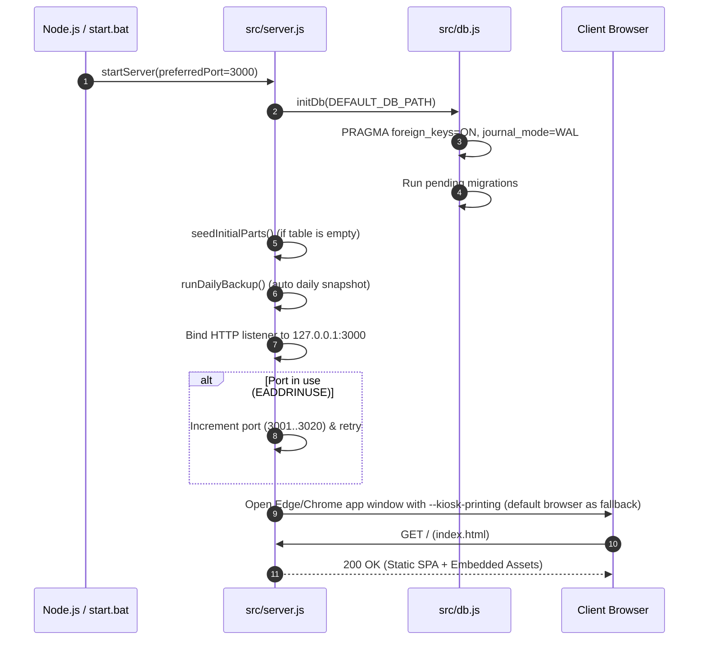

# System Architecture Manual

This document details the architectural design, runtime principles, process lifecycle, asset resolution, and operational boundaries of the **TechParts Phone Repair POS & Inventory Management System**.

---

## 1. Zero-Dependency Architectural Philosophy

The TechParts POS system is designed around a **zero external runtime dependency** philosophy. It runs entirely on the native **Node.js standard library** (v22.5.0+) without any third-party production npm modules.

```
+-------------------------------------------------------------------------+
|                              Node.js Runtime                            |
|                                                                         |
|  +---------------+  +---------------+  +----------------+  +---------+  |
|  |   node:http   |  |  node:sqlite  |  |  node:crypto   |  | node:fs |  |
|  |  (REST Server)|  | (DatabaseSync)|  | (Auth/License) |  | (IO/DB) |  |
|  +---------------+  +---------------+  +----------------+  +---------+  |
+-------------------------------------------------------------------------+
                                    |
                                    v
+-------------------------------------------------------------------------+
|                               Frontend                                  |
|         Vanilla JavaScript SPA + Semantic HTML5 + Tailwind CSS v4       |
+-------------------------------------------------------------------------+
```

### Key Technical Advantages:
1. **Offline-First Operation**: No remote API is needed to sell, print or report; the only outbound calls are the boot-time GitHub update check and, when an operator configures them, the optional cloud sync and manager app.
2. **Deterministic Stability**: Eliminates supply chain risks, dependency rot, version drift, and breakage caused by upstream npm updates.
3. **Low Footprint & Portability**: Runs efficiently on budget shop workstations, Point-of-Sale terminals, or offline laptops.
4. **Direct Binary Packaging**: Simplifies bundling into a single Windows standalone executable (`.exe`) via Node.js Single Executable Application (SEA).

---

## 2. Directory Structure & Subsystems

```
phone-repair-pos/
├── data/                      # Local SQLite databases (shop.db)
├── backups/                   # Automated daily backups (14-day retention)
├── dist/                      # Vendor-only packaged artifacts and manifests
├── release/customer/          # Verified customer output (TechPartsPOS.exe only)
├── docs/                      # Technical manuals and architectural specs
├── public/                    # Frontend client assets (HTML, JS, CSS)
│   ├── js/                    # Vanilla ES-module SPA: main.js (dispatcher), views/, auth.js, receipts.js, api.js
│   ├── index.html             # Single-page application HTML layout
│   ├── report.html            # Standalone read-only manager report (PWA)
│   ├── styles.css             # Custom POS & receipt print styles
│   ├── tailwind.css           # Tailwind CSS source definitions
│   ├── tailwind.build.css     # Compiled standalone Tailwind stylesheet
│   └── icon.svg               # Application branding icon
├── scripts/                   # Tooling, keygen, and packaging scripts
│   ├── build-exe.js           # Windows SEA binary packaging pipeline
│   └── generate-license.js    # Vendor Ed25519 cryptographic keygen CLI
├── src/                       # Backend domain logic and REST API
│   ├── server.js              # HTTP server, routing, and static file serving
│   ├── db.js                  # SQLite initialization, PRAGMAs, and migrations
│   ├── auth.js                # Manager PIN hashing and anti-brute-force lockout
│   ├── settings.js            # Shop settings whitelist, sync URL validation
│   ├── inventory.js           # Parts catalog, barcode indexing, stock control
│   ├── sales.js               # POS transactions, labor items, cart checkout
│   ├── credits.js             # Customer ledger ("Utang") and FIFO settlement
│   ├── returns.js             # Warranty claims, RMA records, stock refunds
│   ├── shifts.js              # Cashier shifts, opening float, variance
│   ├── reconcile.js           # Day close, drawer buckets, signed-period lookup
│   ├── analytics.js           # Daily financial metrics, profit, and valuation
│   ├── audit.js               # Append-only hash-chained audit trail
│   ├── money.js               # Cent rounding helper shared by every money path
│   ├── names.js               # Customer-name normalization and Unicode folding
│   ├── printer.js             # ESC/POS slip layout and PowerShell print transport
│   ├── sync.js                # Push-only outbox sync agent to the cloud
│   ├── updater.js             # GitHub Releases checks, SHA-256 gated self-update
│   ├── license.js             # Ed25519 license verification & machine ID
│   └── seed.js                # Initial standard parts catalog & demo data
├── tests/                     # Unit and integration test suite (node --test)
├── package.json               # Scripts and devDependencies (@tailwindcss/cli)
├── start.bat                  # One-click Windows startup batch script
├── cloud/                     # Optional VPS sync service + manager web app
├── installer/                 # Inno Setup script for the Windows installer
└── dist/vendor-private-key.pem # Vendor private key (strictly offline/vendor-only; never distributed)
```

---

## 3. Server Bootstrap & Process Lifecycle

The backend HTTP server is created in [`src/server.js`](file:///c:/Users/sloth/Downloads/phone-repair-pos/src/server.js) through `createServer()` and started via `startServer()`.



### Port Conflict Resolution
If port `3000` is already bound by another service or another instance of the POS:
- The server captures the `EADDRINUSE` error.
- It automatically attempts the next sequential port (e.g., `3001`, `3002`, ..., up to `preferredPort + 20`).
- Once bound, it logs the workstation URL and opens the browser to that exact port.

### Crash Safety & Uncaught Exception Handlers
To prevent silent process exits and ensure high availability in retail environments:
- Global `uncaughtException` and `unhandledRejection` listeners are registered on the process.
- Errors are appended to `pos-crash.log` in the base directory with an ISO timestamp and full stack trace.

---

## 4. Dual-Mode Asset Resolution

The system operates in two execution modes:

```
                      HTTP GET /js/main.js  (any /js/ or / asset)
                                 │
                 Is running inside compiled SEA .exe?
                                 │
                   ┌─────────────┴─────────────┐
                   ▼                           ▼
                 [NO]                        [YES]
       Read file from disk        Serve from in-memory fallback
       public/js/main.js via fs   global.__EMBEDDED_STATIC__['/js/main.js']
```

1. **Development & Node Runtime**: Static assets in [`public/`](file:///c:/Users/sloth/Downloads/phone-repair-pos/public/) are read directly from the filesystem and streamed to the client with appropriate MIME headers (`text/html`, `text/javascript`, `text/css`, etc.).
2. **Standalone Executable (.exe)**: When packaged via [`scripts/build-exe.js`](file:///c:/Users/sloth/Downloads/phone-repair-pos/scripts/build-exe.js), static assets are embedded directly into `global.__EMBEDDED_STATIC__`. If the client is run without the `public/` directory present on disk, it transparently falls back to the in-memory static bundle.

---

## 5. Transactional Data Architecture

All database write operations across inventory, sales, customer credit adjustments, and warranty returns use SQLite transactions (`BEGIN` ... `COMMIT` / `ROLLBACK`).

- **ACID Guarantees**: A POS checkout atomically records the sale record, inserts line items, and decrements parts inventory. If an item has insufficient stock, the transaction rolls back cleanly.
- **Write-Ahead Logging (WAL)**: `PRAGMA journal_mode = WAL` enables concurrent reads without blocking transaction writes.
