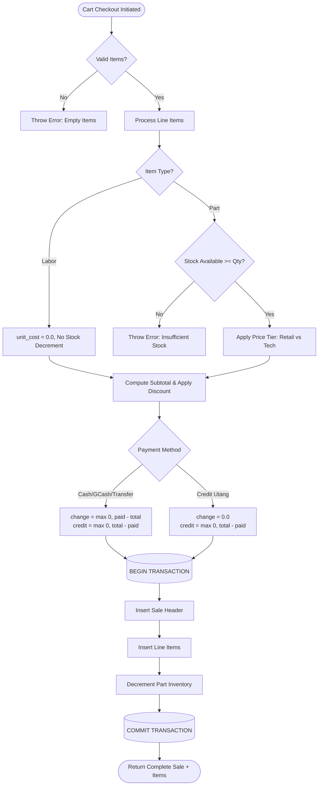

# Core Business Logic & Workflows Manual

This document details the business rules, algorithmic flows, pricing logic, debt settlement mechanisms, RMA handling, and financial metrics implemented in the TechParts POS system.

---

## 1. POS Checkout & Pricing Engine

The POS checkout workflow is implemented in [`src/sales.js`](file:///c:/Users/sloth/Downloads/phone-repair-pos/src/sales.js).



### 1.1 Dual-Tier Pricing Model
Parts support distinct retail and wholesale pricing:
- **Retail (`retail`)**: Applied to walk-in consumers receiving direct repairs or parts purchases.
- **Technician / Wholesale (`technician`)**: Discounted rate applied to partner technicians and wholesale repair shops.

### 1.2 Line Item Processing
- **Physical Parts (`item_type: 'part'`)**:
  - Validates `stock_quantity >= quantity`.
  - Captures `unit_cost = inv.cost_price` at the moment of checkout (preserving accurate historical profit margins).
  - Decrements `stock_quantity` by `quantity` inside the sale transaction.
- **Service Labor (`item_type: 'labor'`)**:
  - `inventory_id` is `null`.
  - `unit_cost` is fixed at `0.0`.
  - Does not modify any inventory stock.

### 1.3 Total & Balance Calculations
$$\text{subtotal} = \sum (\text{unit\_price} \times \text{quantity})$$
$$\text{total\_amount} = \max(0, \text{subtotal} - \text{discount})$$
$$\text{change\_amount} = \begin{cases} 0 & \text{if payment\_method} = \text{'credit'} \\ \max(0, \text{amount\_paid} - \text{total\_amount}) & \text{otherwise} \end{cases}$$
$$\text{credit\_balance} = \max(0, \text{total\_amount} - \text{amount\_paid})$$

---

## 2. Customer Credit Ledger ("Utang") & FIFO Settlement

The customer debt ledger is managed in [`src/credits.js`](file:///c:/Users/sloth/Downloads/phone-repair-pos/src/credits.js).

### 2.1 Debt Accrual
Whenever a sale completes with `amount_paid < total_amount`, the remaining amount is stored on the sale record as `credit_balance`.

### 2.2 FIFO Debt Settlement Algorithm
When a customer pays down their outstanding balance via `POST /api/customers/:name/settle-credit`:

```
Settlement Payment: ₱1,500.00
Customer Open Sales:
  1. Sale #101: Balance ₱800.00  ──► Fully Settled (₱800 paid, Balance: ₱0.00)
     Remaining Payment: ₱700.00
  2. Sale #105: Balance ₱1,200.00 ──► Partially Settled (₱700 paid, Balance: ₱500.00)
     Remaining Payment: ₱0.00 (Exhausted)
```

1. A payment record is inserted into `credit_payments`.
2. Open sales for the customer with `credit_balance > 0` are retrieved in ascending chronological order (`ORDER BY id ASC`).
3. For each open sale:
   $$\text{deduct} = \min(\text{remainingToSettle}, \text{sale.credit\_balance})$$
   $$\text{newBalance} = \text{sale.credit\_balance} - \text{deduct}$$
   $$\text{remainingToSettle} = \text{remainingToSettle} - \text{deduct}$$
4. The loop terminates when `remainingToSettle == 0` or all sales are settled.

---

## 3. Warranty Returns & RMA Operations

Warranty handling is implemented in [`src/returns.js`](file:///c:/Users/sloth/Downloads/phone-repair-pos/src/returns.js).

```
                            Warranty Claim
                                  │
                    ┌─────────────┼─────────────┐
                    ▼             ▼             ▼
             [Replacement]  [Cash Refund] [Credit Refund]
                    │             │             │
        - Check repl. stock   - Refund scales  - Deduct amount from
          >= N units            per unit        sale.credit_balance
        - Decrement stock     (capped at the   (max 0, bal - refund)
          by N                  sale's refundable share)
```

1. **Replacement (`replacement`)**:
   - `quantity` (default 1) is how many units come back; the check is `stock_quantity >= N`, and the target's stock is decremented by N (`rma_replacement` movement).
   - The stock cap and the cross-part-type rule (a different `part_type` needs elevation) are enforced in one transaction.
   - A replacement moves no money: `refund_amount` is forced to 0, so no consumer subtracts anything for it.
2. **Cash Refund (`cash_refund`)**:
   - `refund_amount` is stored and paid back to the customer; the cap is this line's proportional share of the sale.
3. **Credit Balance Refund (`credit_refund`)**:
   - Reduces the outstanding `credit_balance` on the originating sale (never below 0), scaled the same way as the cash path.
4. **Over-return guard**: the sum of `quantity` across a line's returns may never exceed the purchased quantity; every return type refuses once the units are used up.

---

## 4. Analytics & Financial Metrics

Real-time calculation in [`src/analytics.js`](file:///c:/Users/sloth/Downloads/phone-repair-pos/src/analytics.js) computes accurate shop performance:

### 4.1 Profit & Revenue Split
$$\text{Today's Sales Revenue} = \sum_{\text{today}} \text{sales.total\_amount}$$
$$\text{Parts COGS (Cost of Goods Sold)} = \sum_{\text{today, parts}} (\text{quantity} \times \text{unit\_cost})$$
$$\text{Today's Gross Sales Profit} = \text{Today's Sales Revenue} - \text{Parts COGS}$$

*(Note: Service labor has zero COGS, contributing 100% margin to gross profit).*

### 4.2 Operating Expenses & Net Profit
Operating expenses (`expenses` table, booked on the Reports & profit tab) are the P&L leg the sales ledger cannot see. They are **bookkeeping only**: an expense never moves the cash drawer, and day-close reconciliation is untouched.

$$	ext{Net Profit} = 	ext{Gross Profit} - 	ext{Refunds} - 	ext{Replacement Cost} - 	ext{Operating Expenses}$$

Every deduction lands on the date it happened (refunds on the return date, expenses on the booking date), and the trend chart, Z-report, and the cloud mirror all subtract the same window total, so the KPI net, the trend buckets, and the printed report always reconcile to one number.

### 4.3 Cash Reconciliation
$$\text{Total Cash Collected} = \text{Counter Cash Paid Today} + \text{Credit Payments Settled in Cash Today}$$
$$\text{Total GCash Collected} = \text{Counter GCash Paid Today} + \text{Credit Payments Settled in GCash Today}$$
$$\text{Grand Total Collected Today} = \text{Total Cash Collected} + \text{Total GCash Collected} + \text{Transfers}$$

### 4.4 Inventory Valuation
$$\text{Total Inventory Cost Value} = \sum_{\text{inventory}} (\text{stock\_quantity} \times \text{cost\_price})$$
$$\text{Total Inventory Retail Value} = \sum_{\text{inventory}} (\text{stock\_quantity} \times \text{price\_retail})$$

## 5. Repair Ticket Lifecycle

The counter's intake flow (device, IMEI, job note, `RO-` reference) now lands in a
server-side ticket (`repairs` table) instead of dying with the printed claim stub:

1. **Intake.** Holding a job on the counter (or ringing a repair sale) upserts a
   ticket keyed by its `RO-` reference, so hold, sale, and resume can happen in
   any order and the same POST lands the truth.
2. **Bench.** A billed repair moves its ticket to `in_repair` and stores the
   `sale_id` that paid for it; unbilled intakes stay at `intake`.
3. **Queue.** The Repairs tab lists active work (`intake`, `in_repair`, `ready`)
   first by most recent touch, with `released`/`cancelled` sunk below. Status
   changes write a `repair` audit event and mirror to the cloud.
4. **Pickup.** When a ticket reaches `ready`, the Repairs queue offers a
   **Pickup slip** button: it prints a money-free notice (shop header, READY
   FOR PICKUP, the ticket's `RO-` reference, customer, device and job note)
   that brings the customer back. The slip always states the queue's current
   truth because the server reads the ticket row before printing, it never
   opens the drawer, and it can be reprinted freely (no dedup window, same as
   the claim stub); the browser print dialog is the fallback when no thermal
   queue answers. `released` then closes the loop; the ticket stays as history
   (no deletion), and cancelled units keep their audit trail.

Status set: `intake` → `in_repair` → `ready` → `released`, with `cancelled` as
the exit ramp. Any logged-in session may write (technicians need the bench);
no elevation is required because tickets carry no drawer money.
