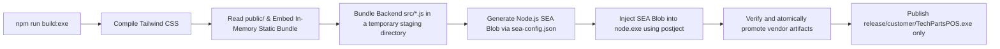

# Operations, Thermal Printing, Backups & SEA Packaging Manual

This document details workstation deployment, standalone Windows executable packaging, thermal receipt printer configuration (58mm/80mm), automated backup lifecycles, and disaster recovery procedures.

---

## 1. Standalone Windows Executable Build Pipeline

The TechParts POS system can be bundled into a single standalone Windows executable (`TechPartsPOS.exe`) with **zero runtime installation requirements** via [`scripts/build-exe.js`](file:///c:/Users/sloth/Downloads/phone-repair-pos/scripts/build-exe.js).



### 1.1 Build Execution Command
```bash
npm run build:exe
```

### 1.2 Pipeline Steps
1. **CSS Compilation**: Runs `@tailwindcss/cli` to produce a minified standalone `public/tailwind.build.css`. Detection is pinned to `source(none)` plus the explicit `@source` globs in `public/tailwind.css`, because automatic detection walks the whole working tree (~1GB of `browser-profile/`, `dist/` and `backups/` here) and that stage then never returns. Markup moved outside those globs must be added to the list, otherwise its styles are silently dropped from the `.exe`.
2. **Static Asset In-Memory Embedding**: Reads HTML, JS, CSS, JSON, SVG and woff2 files into an in-memory dictionary (`global.__EMBEDDED_STATIC__`).
3. **Backend Bundling**: Consolidates every module in `src/` in a temporary staging directory; existing executables and live data remain untouched if the build fails. That includes `src/printer.js`, the ESC/POS module: the column model, the slip renderers, the encoder, and the winspool sender all ship inside the `.exe`, so a packaged workstation prints counter slips with no Node install, no driver round-trip, and no browser layout step.
4. **SEA Blob Generation**: Invokes `node --experimental-sea-config sea-config.json` to generate the Single Executable Application binary blob.
5. **Binary Injection (`postject`)**: Invokes the exact pinned local package without network fallback, injects the SEA blob, then applies the PE subsystem patch. If signing is added later, it must run only after both injection and PE patching.
6. **Verification and Release**: Artifact-specific manifests validate the lockfile, build tooling, runtime version, and each executable's own inputs. Verified outputs are promoted atomically, and `release/customer/` is recreated fail-closed with only `TechPartsPOS.exe`.

One command runs steps 1-6 and stages a handoff copy: `publish.bat` runs the test suite, then `npm run build:exe`, then copies `release\customer\TechPartsPOS.exe` into `publish\` under a name carrying the version and the timestamp, with a `.sha256.txt` sidecar next to it. It reads nothing in `data\` or `backups\`, and everything it writes is regenerable build output. Close the POS before running it: the app is single-instance, so a live one makes the verification boot defer and the run fail. Add `--installer` to compile the Inno Setup installer too.

`dist/` is vendor-only build storage. Never give it to a customer: it may include `LicenseGenerator.exe`, and a working tree may also contain live `data/`, `backups/`, or `vendor-private-key.pem`. Distribute only `release/customer/` after `npm run build:exe` succeeds.

---

## 2. Thermal Receipt Printing System

Counter slips print as native ESC/POS. The server lays the slip out, encodes it, and writes the bytes straight to the Windows queue named in Settings, so nobody at the counter clicks through a print dialog. The browser path (the `@media print` receipt rendered from `public/js/receipts.js` and sent with `window.print()`) is the fallback, never the plan: it is what a customer gets when the queue refuses, and it is still the normal path for the two close-out reports.

```
        Checkout / reprint / settlement / Print test receipt
                              |
                              v
                     POST /api/print  { kind, ... }
                              |
                              v
        src/printer.js: load the row from SQLite, lay the text
        out on the roll's columns, encode ESC/POS bytes
                              |
                              v
        winspool.drv through PowerShell, RAW job, no driver
        rendering. The queue name and the payload travel only
        in environment variables, never on a command line.
                              |
              +---------------+---------------+
              |                               |
        queue took the bytes            queue refused
        200 { ok: true }                200 { ok: false, fallback: true }
              |                               |
        paper off the roll              toast naming the queue, then the
                                        same slip through the browser path
```

### 2.1 The two print endpoints
- **`GET /api/printers`**: the queues on this workstation, each with its port, driver, whether Windows marks it the default, and whether the spooler marks it offline. When the lookup itself breaks the answer is a 502 carrying the reason, which is what lets Settings say "the lookup failed" instead of the lie "you have no printers".
- **`POST /api/print`**: `{ kind: 'test' }`, `{ kind: 'sale', sale_id }`, or `{ kind: 'settlement', payment_id, customer_name }`. The server reads the sale or the collection back out of SQLite, so a dead, stale, or edited tab cannot change what ends up on paper. The answers are fixed: **200 `{ok:true}`** means the queue took the bytes; **200 `{ok:false, error, fallback:true}`** means the printer refused the job; **400** with `fallback:true` is the route's own rejection before anything was written (unknown kind, sale not found, no queue to aim at); **400** with `fallback:false` is the money guard refusing this slip on purpose (see 2.2); **500** with `fallback:true` is a server fault, answered with the generic message and written to `pos-server.log`. `printSlip` in `public/js/receipts.js` reads that `fallback` field rather than guessing from the HTTP status: every `fallback:true` is its cue to print the same slip through the browser path, so a sale is never left without paper, and a `fallback:false` is its cue to stop, because the other sheet would print the same wrong figure.

### 2.2 What the encoder sends, and what it never sends
- **Column model**: 58mm is 32 columns, 80mm is 48, taken from the width saved in Settings. Text wraps at word boundaries inside that budget, and a label that must survive (customer, phone, payment, the utang balance) keeps its label and flows onto the next line rather than being traded away for a long value.
- **Commands**: `ESC @` to initialize, `ESC a` for the centered lines, `GS !` for the double-width shop name, one line feed per row, and `ESC d 3` to print and feed at the end.
- **Drawer kick is on by default for sale, settlement and test jobs, and nothing is auto-cut.** The kick rides the same bytes as the slip (the `ESC p` pulse in `src/printer.js`), so the till opens from the app without the driver option; a caller overrides it per request with `drawer_kick: false`, which every reprint path now sends (a reprint is not a sale and must not pulse the drawer a second time). A caveat the default accepts: a send the queue later refuses has already carried the kick, because the bytes precede the queue's verdict. Cutting stays the printer's own business. See 2.5 below.
- **Plain ASCII only.** Characters outside printable ASCII are stripped before anything is sent, because thermal clones disagree about high-bit code pages. The peso sign is the visible consequence: paper says `P2,700.00` while the screen shows `₱2,700.00`.
- **Money that is not a number is refused, on both papers.** If an amount cannot be read as a finite number the slip is refused while it is still being laid out, before a single byte is encoded, so the queue never hands out a receipt reading `PNaN` or a total that is wrong. The refusal is deliberate, so the route answers **400 with `fallback:false`** and the tab does not retry the figure through the browser: the two paper formatters, `money()` in `src/printer.js` and `printMoney()` in `public/js/receipts.js`, apply the one finite-number rule (`isFiniteAmount` in `public/js/ui.js`) and refuse to state the figure, and a receipt modal opened on such a row shows the reason in place of the slip and prints nothing. The shared screen formatter `fmtMoney` does not throw: it shows `₱--`, because it runs at list-view scale and a throw there used to repaint an entire sales history as "the server didn't answer" over one bad row. A printer fault, a missing row or a server fault still carries `fallback:true` and the browser path still runs, because a shop must never be unable to hand over a receipt. In practice a sale cannot be stored with such an amount (`src/money.js` refuses it at write time), so this is a wall against a corrupted or hand-edited row, not a daily occurrence.
- **Stamp is shop time.** The date and the warranty expiry on paper are the workstation's local date, not the UTC the audit rows and SQLite store, so a receipt is never eight hours behind the counter clock.

### 2.3 Setting up printing on a new shop

Do it once per workstation, in this order:

1. **Install the printer's Windows driver** and load the roll. Set the paper size in the driver's printing preferences (58mm or 80mm) to match the paper actually installed.
2. **Open Settings → Printing.** Under **Receipt printer** the picker lists this machine's queues. It shows `Detecting printers...` while it works, then either the queues (with port, `default`, and `offline` where the spooler reports it), or `No printers found. Check the cable, then Refresh.` on a machine that genuinely has none, or a reason line when the lookup itself failed. **Refresh list** re-reads without reopening Settings. A queue the spooler marks offline is tagged only when other queues are online: this machine has been seen reporting every queue offline at once while its only working printer printed fine, so the tag never blocks a print.
3. **Pick the queue and Save changes.** The name is checked against the installed queues at the save, so a typo or a renamed device is refused there rather than on a customer's receipt. Leaving it empty is a real choice too: the server then aims at the Windows default queue while that queue is online, at any other online queue if the default is offline, and at the offline default only as a last resort so the picker still names the queue to fix.
4. **Set Thermal printer width** to the roll in the machine. The paper's column count comes from this setting.
5. **Click Print test receipt.** It prints the shop name, a ruler, the alphabet, and a sample money row. If both ruler lines touch both edges of the paper, the width matches the roll. If they stop short or wrap, go back to step 4. The test slip prints even before the shop details are real, which is the point of it.
6. **Save the real shop details** in Settings (shop name and GCash number). Until then every sale is refused paper rather than print a receipt carrying the built-in demo identity; the toast says `Sale recorded, but the receipt was not printed: shop identity is still the placeholder`, and the sale itself is stored and can be reprinted once the details are saved.
7. **Ring one sale.** Paper should come off with no dialog and no toast.

**What a failure looks like, and what happens on its own:**

- A toast that names the queue (`Printing to 'X' failed: ...`) means the job never left the queue. The tab immediately prints the same slip through the browser path instead, so the customer still gets a receipt. In the app window the launcher opens, that fallback also goes out with no dialog; in a browser you opened by hand it shows the print dialog and someone has to press Print. Settings → Printing states which of the two this window is.
- `No printer found. Check the cable, then Refresh in Settings.` means there was no queue to aim at at all, which is a cable, a powered-off printer, or a spooler problem, not a settings problem.
- `Saved printer "X" is not installed here. Pick one and save.` in Settings means the queue the shop was using was unplugged, renamed, or reinstalled. Prints keep falling back to the browser until a queue is picked again.
- A print with the paper looking right but nothing in it: the width in Settings does not match the roll. Step 4, then the test slip again.

### 2.4 What still prints through the browser, on purpose

The Z-report and the Reports tab's period summary are the two documents left on the browser print path. That is a decision, not work carried over from the move to ESC/POS: they are close-out sheets a human signs at the end of the day, they are label-and-value tables whose columns are wider than a receipt's 32 or 48 characters, and nobody is standing at the counter waiting on one, so a dialog in the way costs nothing. They are also guarded the same way the slips are: a shop still carrying the placeholder identity is refused outright rather than printing a report in somebody else's name.

The browser path keeps its own rules, because it is still the path a fallback takes:
- **Monochrome**: strict black-on-white (`#000` on `#fff`) at print time, with the app chrome taken out of the layout rather than only unpainted, so Chromium's shrink-to-fit pass cannot burn a blank strip.
- **Roll width classes**: the printable copy takes `.thermal-80mm` (72mm box) or `.thermal-58mm` (48mm box) from the same width setting the ESC/POS columns come from, and `@page` is sized to the roll with a zero margin.
- **Same content, same labels, one money shape.** The fallback shows the same fields in the same order with the same labels as paper ("WARRANTY (", "Payment received:", "Remaining balance:", "RETURNS / REFUNDS"), and both format money through the same digits and grouping (P1,234.56) via twenty call sites. A sale with warranty returns itemizes each RMA (code, quantity, item, replacement or amount) on paper and in the fallback, matching the receipt modal, so the customer's slip and the counter's screen agree about what was returned. A paid-off settlement says PAID IN FULL on both papers. Dates stay medium-shaped on purpose: the screen and the fallback copy say "Oct 7, 2026" while paper says 2026-10-07, because the ISO date belongs on the warranty-claim slip. The Z-report and the period summary remain browser-only. Sale receipts carry five templates (Standard, Compact, Boxed, Airy, Grid) chosen shop-wide in Settings; the preview endpoint renders the same builder the queue prints.
- **No GCash QR on any printed slip.** The shop QR is shown on screen at the payment step and in Settings; a printed receipt carries the GCash number as text (`Tel/GCash: ...`) on paper and in the browser alike.

## 2.5 Cashier Hardware Setup (Printers, Cash Drawers & Barcode Scanners)

1. **Thermal Receipt Printer** (POS-58 / POS-80 / Epson / Xprinter):
   - Install the Windows driver that shipped with the printer (or the vendor's download). The driver is what puts the queue on the machine; the slips themselves go to it as RAW ESC/POS and are not rendered by it.
   - Name that queue in **Settings → Printing** (see 2.3). Setting it as the **Windows default printer** is still what an unconfigured shop prints to, because the server falls back to the default queue when Settings names none.
   - In driver printing preferences, select the **58mm or 80mm continuous roll** paper size matching the installed paper, so the browser fallback prints on the right form. The ESC/POS path does not read driver margins; the column count comes from the width saved in Settings.
   - Set **Margins: None** and disable **Headers/Footers** (page numbers, URLs). The app's `@page { margin: 0 }` already suppresses these in Chromium-based browsers.

2. **Kiosk Silent Printing**:
   - The server auto-launches the workstation in an Edge/Chrome **app window** with `--kiosk-printing`. Since the slips print through the queue, this flag is no longer what makes printing silent; it is what makes the **browser fallback** silent, so an app window opened by the launcher or `start.bat` never shows a dialog even on the fallback path.
   - The window keeps its title bar (not fullscreen kiosk). Closing it ends the session and the server exits via its heartbeat watchdog.
   - The lockdown swallows F5, Ctrl+R and Ctrl+P on purpose: a hung tab is recovered by closing the window (the watchdog restarts cleanly), and a receipt reprint lives on the receipt modal's Print button, never on a keyboard shortcut. ALT+P on the POS tab prints the repair claim stub through the same queue (with the browser path behind it), so no keyboard route bypasses the print pipeline.

3. **Electronic Cash Drawer**:
   - Connect the drawer's RJ11/RJ12 cable to the printer's **DK (drawer kick)** port.
   - Nothing else is required: every sale, settlement and test slip carries an ESC/POS kick pulse, so the drawer opens from the app. Enabling **"Open Cash Drawer #1 Before/After Printing"** in the printer's advanced properties on top of that would pulse it twice per sale, so leave that option off.
   - Reprints do not kick: the reprint paths send `drawer_kick: false`. The manual key remains the fallback if the printer's DK port is not wired.

4. **USB Barcode Scanner**:
   - Plug-and-play in HID **keyboard wedge** mode; configure the scanner's suffix to **Enter (CR/LF)** (factory default on most models).
   - Pull the trigger anywhere on the POS tab and the burst is read as a part code, wherever the caret sits: nothing focused, the parts search, or a counter field such as the customer name. A new repair opens with the caret in the parts search for exactly this reason.
   - A successful scan beeps and adds the part to the cart. Unknown codes, out-of-stock parts and over-quantity scans buzz and are refused — an unknown code is never quietly matched to "the closest part".
   - Five fields keep a scan as plain text on purpose: the device box and the IMEI box (a phone's own carton carries that number, and reading it is what those boxes are for), the job note, and the two money boxes (tendered and discount). Scanning into a part lookup there would be wrong, not helpful.
   - Typing at ordinary human speed is not read as a scan: the burst gate requires a gap under 100ms between every key plus at least 6 characters inside a field. A very fast typist (under 100ms per key) in a non-exempt field can still trip the gate; the money and intake fields are exempt, and a hijacked burst restores the field's prior text.

### 2.6 What a print leaves behind
A print the route accepted or turned down on purpose writes one audit row under category `print`: the job kind (`test`, `sale`, `settlement`, or `unknown` for anything else), the queue it was aimed at, and whether the bytes were delivered or refused. A rejection before any byte was written carries the reason and no queue, because none was chosen. A server fault that lands in the 500 branch writes no audit row at all, only a line in `pos-server.log`, since the database is the thing that just failed.

**A delivered print that lost its audit row exists only in `pos-server.log`.** The route records delivery *before* it writes that audit line, not the other way round. Everywhere else in `src/server.js` a failed audit rolls its own side effect back with it; printed paper cannot roll back, and `audit_log` is append-only, so a wrong row can never be corrected either. The failure this ordering prevents is the expensive one: if a lost audit could answer as a failed print, the tab would fall back to the browser path and hand the customer a **second** receipt for one sale. So when the database refuses that one write, the print still answers `200 {ok:true}`, the counter sees a success, and the missing row shows up as `POST /api/print audit failed after delivery: ...` in the log. That line is the only trace the slip ever existed, which is a deliberate consequence of the ordering, not a gap to close: the audit trail records what the shop set out to print, the roll records what the customer got.

---

## 3. Automated Daily Backups & Disaster Recovery

Data safety is managed in [`src/server.js`](file:///c:/Users/sloth/Downloads/phone-repair-pos/src/server.js) via `runDailyBackup()` and `createDbBackup()`.

### 3.1 Daily Backup Lifecycle
```
                 POS Server Starts Up (startServer)
                               │
                 Has backup been created today?
                               │
                 ┌─────────────┴─────────────┐
                 ▼                           ▼
               [YES]                        [NO]
          Skip auto-backup           1. Snapshot database via VACUUM INTO to:
                                        backups/shop-YYYY-MM-DD.db
                                     2. Update last_backup_date setting
                                     3. Prune backup files older than 14 days
```

1. **Automated Trigger**: Executed on server startup and then once an hour. `runDailyBackup` is idempotent per calendar date, so the hourly tick only lands a snapshot when the date has rolled over. A workstation left running for days therefore carries a data-loss window of about one day, not one that grows with uptime. Each snapshot is checked with `PRAGMA integrity_check` while it is still a temporary file: a backup that does not verify is discarded and the previous good copy is left in place.
2. **14-Day Retention Pruning**: Backups older than 14 days (`cutoff = Date.now() - 14 * 86400000`) are automatically pruned to prevent uncontrolled disk usage.
3. **On-Demand Manual Backup**: Shop owners can trigger instant backups via the Dashboard or `POST /api/backup`.
4. **Synchronous Freeze Window (expected behavior)**: `VACUUM INTO` runs inside the single-threaded server, so requests in flight while a backup runs block until it finishes (stress-measured: ~3.6s at 100k sales / ~20MB database; scales with database size). The daily startup backup completes before the browser opens, so shops normally never notice. A manual backup briefly freezing the UI is normal, not a hang. If a shop's database grows large enough that this hurts, the fix is running the snapshot on a worker thread — not needed at single-counter scale.

### 3.2 Disaster Recovery & Database Restore Procedure
If workstation hardware fails or data requires restoration:
1. Ensure the POS application is closed (`start.bat` or `TechPartsPOS.exe` stopped).
2. Locate the most recent healthy snapshot in `backups/` (e.g. `backups/shop-2026-08-26.db`).
3. Delete `data/shop.db-wal` and `data/shop.db-shm` (if present) before restarting, preventing live WAL journals from replaying over the restore.
4. Copy the backup file to `data/shop.db` (overwriting the current database).
5. Restart the POS application. SQLite will automatically open the restored database, verify WAL journal integrity, and resume normal operations.

### 3.3 Mirroring backups off the workstation (required for real DR)
Automatic and manual backups both land in `backups/`, which sits on the same physical disk as `data/shop.db`. That survives a mistaken void or a corrupt write; it does not survive a dead disk. Copy the folder somewhere else on a schedule:

```
set POS_BACKUP_MIRROR=\\NAS\pos-backups
node scripts\mirror-backups.js
```

`POS_BACKUP_DIR` overrides the source folder when the backups do not live in the default place. The script uses `robocopy`, so it is Windows-only, and exits non-zero if the mirror did not happen, which is what a scheduled task needs to notice a failure. Nightly, at the machine's own clock:

```
schtasks /Create /SC DAILY /TN TechPartsMirror /TR "node C:\TechParts\scripts\mirror-backups.js" /ST 21:00
```

On a packaged-exe install the live data home is `%LOCALAPPDATA%\TechPartsPOS`, not the project folder. The script detects this automatically (it prefers the exe home whenever `%LOCALAPPDATA%\TechPartsPOS\data\shop.db` exists) and mirrors the live backups; `POS_BACKUP_DIR` still wins for explicit setups. The single-instance lock also lives machine-wide (`%LOCALAPPDATA%\TechPartsPOS\server.lock`), so the exe and a development instance hand off port 3000 instead of silently racing.

The dashboard's Standing panel states the age of the newest backup file it can find and marks it overdue past a day plus slack. Because the mirror is a separate step, that number describes the workstation copy only: an overdue warning next to a healthy mirror is a share problem, not a shop data problem.

---

## 4. Workstation Troubleshooting & Crash Diagnostics

### 4.1 Diagnostic Logs (`pos-crash.log`)
If an uncaught exception occurs:
- The system captures the event via process safety handlers.
- The timestamp and full error stack trace are appended to `pos-crash.log` in the application directory.

### 4.2 Port Conflict Resolution
- If port `3000` is in use, the server automatically iterates through ports `3001` up to `3020`.
- Check the console output or browser URL bar to confirm the active port.

### 4.3 Performance Ceilings (stress-tested, accepted)
- **Request concurrency:** sustained ~1,300 req/s with correct responses; p50 stays ~1ms up to ~200 in-flight requests. Beyond ~200 *simultaneous* in-flight requests, newly arriving connections may be refused (`ECONNREFUSED`, ~43% of a 500-connection burst) until the backlog drains — transient, retries succeed, no data risk. That is roughly 50 browser tabs on one counter PC; far beyond single-shop usage, so no mitigation is planned.
- **Writes:** ~390 sales/s with stock integrity intact under 300-way contention; SQLite serializes writers correctly.
- **Customer list:** capped at 2,000 rows per response (largest debts first). Realistic shops stay far below; add pagination if a shop ever passes ~2,000 customers.

---


## 5. Cloud Sync & Remote Manager App (Optional, per shop)

The workstation is fully offline-first: with no cloud URL configured, nothing ever leaves the shop. When the owner wants live remote monitoring, an optional zero-dependency cloud service (`cloud/server.js`) runs on any VPS and mirrors the shop. The shop remains the source of truth for sales and the ledger: the cloud cannot edit a sale or a debt. The cloud CAN push two stock commands back down to the register (a stock adjustment and a CSV inventory import, see 5.5), so a VPS outage never touches the counter, but a compromised manager session can move stock. There is no conflict resolution for sales.

### 5.1 How it works
- Every write (sale, stock move, utang settlement, warranty return, day close, drawer adjustment, credit profile) enqueues a full row snapshot in `sync_outbox` inside the same transaction.
- The shop server drains the outbox 2 seconds after any finished write (plus a 60s safety tick). Failures back off from 30s to 5min, so a down VPS never gets spammed. Synced outbox rows older than 30 days are purged automatically; while sync is off, unsent rows older than 30 days are pruned too, so an offline shop's outbox stays bounded (enabling sync later backfills the most recent month).
- The cloud keys rows by `(shop_id, table, local_id)`: retries are idempotent. Returns and credit settlements carry a client `op_id` (like sales always have), so a timeout retry replays instead of double-applying.
- The cloud manager app (`cloud/public/`) logs in with its own manager PIN and receives Server-Sent-Events pushes, so a sale lands on the owner's phone within seconds. It shows period reports (today / 7 / 30 days), top parts, utang and low stock. The cloud supports multi-tenant store accounts: each store has its own PBKDF2-hashed PIN and sees only the shops attached to that store (`shops.store_id`). A server manager PIN can add stores; the first-run `default` store is claimed through `POST /api/setup-pin`.
- The workstation's topbar shows a sync chip whenever a cloud URL is configured.

### 5.2 One-time VPS setup
1. Copy the repo to the VPS (Node.js 22.5.0+) and run `node cloud/server.js`. Environment: `PORT` (default 8443), `HOST` (default `127.0.0.1`, safer than a public bind), `DATA_DIR` (default `cloud/data`).
   - **Clock**: every analytics window buckets by the SHOP's clock, and the mirrored timestamps are the register's UTC stamps. If the VPS runs on the shop's timezone (for example `Asia/Manila`), nothing is needed. On a UTC VPS set `SHOP_TZ_OFFSET_MINUTES=480` (minutes east of UTC) or the manager app's day buckets sit hours off the day close; the boot log names the effective clock either way (`[clock] analytics bucket by ...`).
   - **`MANAGER_PIN`**: a value in this environment variable wins over the PIN file. Setting it to an empty string is a configuration error and the service refuses to boot, because a blank value used to reopen the unauthenticated first-run setup with no warning.
   - A present-but-blank `MANAGER_PIN` (or any startup error) exits with the reason on stderr; check the unit's journal before assuming the service started.
2. On first run it mints the per-shop sync credentials, prints that token once, and saves it under `DATA_DIR` (`sync-credentials.json`, 0600) together with `manager-pin.txt`. Record the token. The manager app PIN is not printed: the app's first-run screen sets it through `POST /api/setup-pin` (that route is a bootstrap only, refused once a PIN exists). To rotate the manager PIN later, run `node cloud/server.js --rotate-pin`, record the new PIN from the output, and restart the service (the restart also signs out all manager sessions). The rotation writes an 8-digit keypad-typable PIN; a legacy 48-hex PIN file left by an older build is migrated to the same shape on first read (and the new PIN is printed once), so a rotation or a legacy file never reopens first-run pin setup.
3. Put it behind a TLS reverse proxy. The service itself is plain HTTP by design and must never be exposed directly to the internet. If the proxy terminates TLS, set `TRUST_TLS_PROXY=1` so session cookies get the `Secure` flag, responses carry HSTS, and the manager-login lockout keys on the proxy-forwarded client IP (the LAST `X-Forwarded-For` entry, which the proxy writes; `TRUST_PROXY=1` enables the same forwarding trust). Without a trust env the proxy headers are ignored and every client shares one lockout bucket.

   Caddy (automatic HTTPS):

   ```
   pos.example.com {
     reverse_proxy 127.0.0.1:8443
   }
   ```

   With nginx, disable buffering on the events path or SSE stalls: `location /events { proxy_pass http://127.0.0.1:8443; proxy_buffering off; }`
4. Keep it alive: a systemd unit or `pm2 start cloud/server.js --name techparts-cloud`.

### 5.3 Shop-side setup
Cloud sync pairs by 6-digit code, and the cloud service URL is a managed, readonly link (Settings → Data shows it as the Telemetry service link): the operator never pastes a URL or token by hand. The flow:

1. In the cloud app (TechParts Live), press **Pair Register** and note the 6-digit code (valid 10 minutes).
2. On the workstation, Settings → Data → **Pair this register**, enter the code. Pairing registers this machine's stable shop id (`sync_shop_id`), stores the per-shop credential, and immediately backfills the mirror: current inventory and customer (utang) profiles in full, plus the last 30 days of sales, items, movements, payments, returns, shifts, reconciliations and adjustments. Older sales stay local by design (the cloud dashboard only ever shows Today / 7 / 30 days).
3. The topbar chip shows `Syncing N changes` while the backfill drains, then `Cloud synced` once the cloud accepted everything. While a URL is configured the workstation also heartbeats once a minute even when there is nothing to send; that heartbeat is what keeps the shop's "online" badge truthful on the dashboard.
4. If the chip says `Cloud sync error` (hover for the reason), the last push or heartbeat was refused, most often because the shop was unlinked on the cloud (botkeep) while this register still held its credential: re-pair with a fresh code to restore the link. The error clears itself on the next successful push.
5. If pairing itself answers `The cloud did not answer within 15 s. The pairing may have completed on the cloud side anyway...`, the register gave up waiting while the cloud may already have spent the code and paired this shop id. Retrying with a new code answers 409 (already paired); pushes will answer 401 until the vendor rotates the shop's credential on the cloud server. The error message names the shop id to quote.

Unlinking from the cloud side (the dashboard's Unlink) removes that shop's mirror rows and credential; the workstation learns about it on the next heartbeat, which the cloud answers 401. Unlinking from the workstation (Settings → Disconnect) stops all pushing and hides the chip. Env vars `SYNC_URL` / `SYNC_TOKEN` override the settings when present and win at drain time, so a paired target is silently shadowed while `SYNC_URL` is exported: unset it after pairing.

### 5.4 Reseller checklist for a new customer workstation
1. Run `npm run build:exe`, copy only `release/customer/` to the workstation, launch `TechPartsPOS.exe`, and activate the license (`docs/SECURITY_AND_LICENSING.md`). Then set up printing before the first customer: Settings → Printing, pick the queue, save, and print the test slip (section 2.3). The packaged app refuses to keep its data inside a folder that looks like a release directory (any path containing a `release` segment) and uses `%LOCALAPPDATA%\TechPartsPOS` instead, so a local smoke run can no longer leave `data/` and `backups/` behind for the next copy to ship.
2. Have the owner change the Manager PIN from the factory default in the app. For an offline reset, explicitly target the intended database with `node scripts/set-pin.js --db <path-to-shop.db> <pin>`; the update is one transaction and never writes a second database implicitly.
3. If the customer bought the cloud option: pair the shop by 6-digit code as in 5.3 (the URL field is managed and readonly; pairing is the only UI path); the owner opens the cloud app on their phone and logs in with the cloud manager PIN.
4. Without any cloud, the manager can still open the lightweight read-only report on their phone. See section 5.6 for the three ways to reach it and the acknowledgement a plain-LAN bind requires.

### 5.5 Security notes
- The cloud app PIN and the shop manager PIN are separate credentials; a leaked phone login never unlocks the counter.
- Five wrong cloud PIN attempts lock cloud logins for 5 minutes (in memory; a restart clears it).
- Shop → cloud traffic authenticates with the sync token header, checked before any request body is parsed; a small per-client request budget answers 429 to floods, which feeds the shop agent's normal backoff. TLS belongs on the reverse proxy.
- A `sync_url` saved through Settings must be https and must not resolve to a private address; a hostname that fails to resolve at save time is saved with a warning instead of blocking.
- The cloud mirror (`cloud.db`) backs itself up daily into `DATA_DIR/backups/` (integrity-checked, 14-day retention). The cloud view is disposable-in-disaster: restore from those snapshots; the shop remains the source of truth and there is no re-push-history mode.
- Sales and ledger data flow one way (shop to cloud). The cloud can push two stock commands down to the shop: `adjust_stock` (a signed quantity delta) and `import_inventory` (CSV rows). The shop applies them through the same `adjustStock`/`importInventory` paths the counter uses, with an `op_id` so a redelivered command replays instead of doubling stock, and acks them on the next drain. A stolen manager session or a hostile VPS can therefore move register stock; it cannot edit sales or debts.

### 5.6 LAN report (no cloud): acknowledgement and TLS options
The read-only phone report at `report.html` is reachable on loopback only by default, so nothing outside the workstation can see it. Opening it on the shop Wi-Fi means starting the server with a non-loopback `HOST`, which exposes customer names, phone numbers and utang balances to every device on that network over plain HTTP. Because that is a deliberate operator decision, the server refuses the whole `/api/report/*` namespace until it is acknowledged:

```
HOST=0.0.0.0
POS_LAN_REPORT_ACK=1
```

Without the acknowledgement, report requests answer 403 and say why. Three ways to serve the manager's phone, strongest first:

1. **Tailscale (recommended).** Join the workstation and the phone to one tailnet, then run `tailscale serve --bg --https=443 http://127.0.0.1:3000`. The phone opens `https://<workstation>.<tailnet>.ts.net/report.html`. The workstation keeps its loopback bind, TLS terminates at Tailscale, and no shop port is exposed to the LAN at all. The same-origin gate accepts the `*.ts.net` request, so neither `HOST` nor the acknowledgement is needed in this shape.
2. **Reverse proxy with TLS on the box.** Bind loopback and let Caddy or nginx terminate HTTPS and proxy to `127.0.0.1:3000`. Also same-origin, so no acknowledgement is needed.
3. **Plain LAN.** `HOST=0.0.0.0` plus `POS_LAN_REPORT_ACK=1` on a network you control. This is plaintext on the LAN and the report token is a bearer credential, so only do it where every device on the network is yours.

Report logins carry their own attempt counter and a 15-minute lockout window, separate from the counter PIN gate: five guesses from a phone cannot freeze the register.
