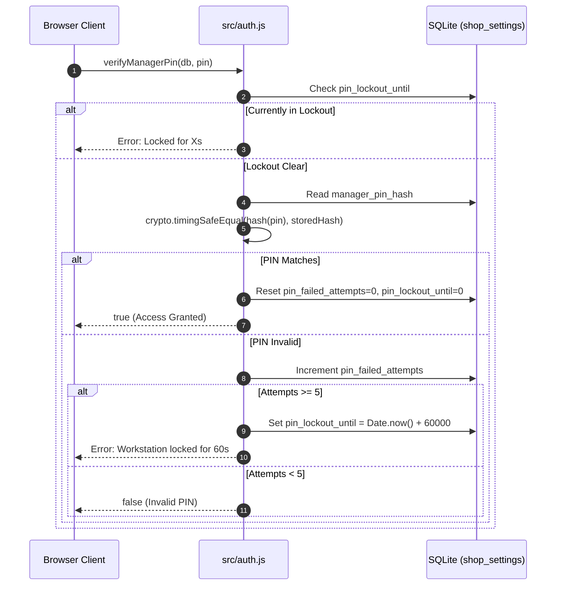

# Security Architecture & Cryptographic Licensing Manual

This document details the authentication safeguards, anti-brute-force defenses, timing attack protections, machine fingerprinting, and Ed25519 asymmetric cryptographic licensing built into the TechParts POS system.

---

## 1. Manager PIN Security & Access Control

Manager actions in the web UI and protected local API routes require authenticated sessions and permission checks via [`src/auth.js`](file:///c:/Users/sloth/Downloads/phone-repair-pos/src/auth.js). Manager elevation is required for protected cashier actions and server-derived actors are used for auditing.

### 1.1 Hash Storage & Verification
- **Hashing Algorithm**: PBKDF2-HMAC-SHA-256 with 100,000 iterations and a random per-PIN salt. Legacy unsalted SHA-256 rows remain readable and are upgraded after a successful login.
- **Timing-Attack Defense**: Password comparisons utilize `crypto.timingSafeEqual(inputBuffer, storedBuffer)` to prevent timing side-channel attacks.
- **Default Factory PIN**: The initial PIN is `1234` (`DEFAULT_PIN_HASH = 03ac674...`).
- **Mandatory PIN Change Prompt**: When `isDefaultPin(db)` is `true`, `GET /api/settings` flags `pin_change_required: true`, prompting the shop owner to change the PIN upon startup.
- **Factory-PIN Refusal**: because `1234` is printed in the manual, elevation granted against it proves nothing, so the consequential manager paths refuse it until the PIN is replaced (HTTP 403 `elevation_required`): `POST /api/auth/elevate`, shop settings saves, starter seeding, cloud pairing, the day close, CSV import, inventory bulk-edit, backup restore, demo reset, system shutdown, and the self-update apply. Login still issues the session (the UI needs it to reach `change-pin`), and `change-pin` is deliberately reachable without elevation while the factory PIN is live so first-run setup can complete.



### 1.2 Persistent Anti-Brute-Force Defense
- **Maximum Failed Attempts**: 5 consecutive attempts.
- **Lockout Duration**: 60 seconds (`LOCKOUT_MS = 60000`).
- **Database Persistence**: Lockout state (`pin_lockout_until` and `pin_failed_attempts`) is persisted directly in `shop_settings` in SQLite rather than volatile RAM. Closing and restarting the process cannot bypass the lockout timer.

### 1.3 Setting Isolation (`PRIVATE_SETTINGS`)
To prevent unauthorized privilege escalation through settings API endpoints:
- `PRIVATE_SETTINGS = new Set(['manager_pin_hash', 'license_key', 'pin_failed_attempts', 'pin_lockout_until', 'report_pin_failed_attempts', 'report_pin_lockout_until', 'report_token', 'report_token_expires_at', 'counter_session_secret', 'sync_token'])`.
- `GET /api/settings` automatically strips private security keys from the payload. Staff sessions additionally never see `sync_url` or `sync_shop_id` (the VPS address is infrastructure detail).
- `POST /api/settings` rejects any attempt to overwrite these keys.
- A `sync_url` saved here must be https, must not be a private literal, and must not resolve to a private address (checked at save time only).

---

## 2. Offline Cryptographic Licensing Engine

The licensing engine ([`src/license.js`](file:///c:/Users/sloth/Downloads/phone-repair-pos/src/license.js)) guarantees offline commercial protection without requiring a remote licensing server.

### 2.1 Cryptographic Model (Ed25519 Asymmetric Signatures)

```
       [VENDOR SECURE MACHINE]                       [CUSTOMER WORKSTATION]
                                                
    +---------------------------+              +-------------------------------+
    |  vendor-private-key.pem   |              |     src/license.js            |
    |    (Ed25519 Private Key)  |              | (Embedded Public Key: Base64) |
    +---------------------------+              +-------------------------------+
                  |                                            |
                  v                                            v
    scripts/generate-license.js                 crypto.verify(payload, pubKey, sig)
                  |                                            |
                  +========= [License Key] ====================+
```

1. **Vendor Private Key**: Remains strictly offline in the vendor's custody (`vendor-private-key.pem`).
2. **Vendor Public Key**: Encoded as SPKI DER Base64 and embedded in [`src/license.js`](file:///c:/Users/sloth/Downloads/phone-repair-pos/src/license.js) (`VENDOR_PUBLIC_KEY_B64`). The client binary can only verify signatures and can never forge a license.
3. **Transition Key**: the 2026-10-14 key rotation replaced that constant, which would have stopped every already-activated seat from validating on its next update. The previous public key ships beside it (`VENDOR_PUBLIC_KEY_PREVIOUS_B64`) and verification falls back to it, so keys minted before the rotation keep working. It is a verify-only key; remove it once no pre-rotation seat is left in the field.

### 2.2 Machine Hardware Fingerprinting
Machine IDs are computed from OS and CPU properties. The hostname is deliberately not part of the hash (it used to be, so renaming a PC silently invalidated a paid seat with no recovery besides a re-mint):
$$\text{Raw} = \text{Platform} + \text{"|"} + \text{Architecture} + \text{"|"} + \text{CPU Model}$$
$$\text{Hash} = \text{SHA-256}(\text{Raw})$$
$$\text{Machine ID} = \text{"TP-" + Platform[:3].Upper() + "-" + Hash[0:4] + "-" + Hash[4:8]}$$
*(Example format: `TP-WIN-8F12-A3D9`).*

Keys minted before the change carry the hostname-bound ID, so verification accepts both the stable ID (`getMachineId()`) and the legacy one (`getLegacyMachineId()`); the activation screen and the vendor CLI mint new keys with the stable ID only.

### 2.3 License Key Format & Token Structure
A license key is a two-part base64url string separated by a dot (`.`):
$$\text{License Key} = \text{Base64URL}(\text{Payload JSON}) + \text{"."} + \text{Base64URL}(\text{Ed25519 Signature})$$

**Payload Schema:**
```json
{
  "machine_id": "TP-WIN-8F12-A3D9",
  "plan_type": "lifetime",
  "expires_at": "",
  "customer_name": "Metro Tech Shop"
}
```

### 2.4 License Types & Validation Rules
- **Lifetime License (`plan_type: 'lifetime'`)**: `expires_at` is empty; `days_left` returns `99999`.
- **Time-Limited License (`plan_type: 'monthly'` or `'yearly'`)**: Valid through the date-only `expires_at` value. Legacy `'subscription'` payloads remain recognized. The CLI rejects malformed or negative `--days` values rather than silently issuing a lifetime key.

---

## 3. Trial & Enforcement Model

The shipped `.exe` is trial-ware: 14 days of full function from first run, then every
`/api/` endpoint except `/api/auth/login`, `/api/auth/change-pin`,
`/api/license/status`, `/api/license/activate`, `/api/system/shutdown`,
`/api/system/heartbeat`, `/api/system/update/check` and `/api/system/update/apply`
returns **HTTP 402 Payment Required**. Static files stay
ungated so the lock screen loads, and the exempted routes still authenticate
internally. Customer data is never deleted; activation restores access
immediately. The daily startup backup also keeps running on expired installs.
The two update routes stay exempt so a lapsed install can still be brought
forward; the apply route keeps its own elevated-session and factory-PIN gates
(see section 4), so being reachable is not being ungated.

### 3.1 Trial State (`shop_settings`)
| Key | Meaning |
|---|---|
| `first_run_ts` | ISO timestamp of the first run of the build; trial end = first run + 14 days. |
| `last_seen_ts` | High-water mark of observed clock time; advanced at most once per hour (throttled write on the read path, so rollback is caught while running, not just across restarts). |
| `trial_compromised` | `'1'` once a clock rollback beyond the 24h tolerance or direct database tamper is detected. **Permanent** — only activation opens the gate, the flag itself is never cleared. |
| `trial_seal` | HMAC-SHA256 seal over `machine_id`, `first_run_ts`, and `trial_compromised`. Any external SQLite edit to `first_run_ts` or `trial_compromised` mismatches the seal and trips `trial_compromised = '1'`. A recomputed seal over an edited `first_run_ts` is still floored to the database file's birth time (a settings-row edit cannot move it), so resetting the trial by recomputation is caught unless the file itself is copied or moved. |

`GET /api/license/status` reports `trial_active`, `trial_days_left`, and
`license_required = !activated && !trial_active`. A demo-data reset clears only the
five data tables, so trial state survives it.

### 3.2 Clock-Rollback Policy
24 hours of tolerance (normal DST/timezone jitter never trips it). Beyond that, the
trial is flagged compromised and the workstation requires activation. Known ceiling:
a dead CMOS battery mid-trial can look like a rollback — the prospect activates
early. Activation is never blocked.

Activated, time-boxed licenses use the same idea without locking anyone out: a
monotonic `license_seen_ts` high-water mark (advanced at most once per hour, and
never recording a wild forward jump) is compared against the expiry date, so
setting the PC clock back cannot extend a monthly or yearly key. A correction
inside the 24-hour tolerance is invisible to this rule.

### 3.3 Customer-Facing Reissue Wording (hardware/hostname change)
> Your Machine ID changed because this is a different computer. Your sales, customer
> ledger, and inventory are safe on this computer — activating restores full access
> immediately. Read the Machine ID from the activation screen, send it to your vendor
> with your proof of purchase, and paste the new license key you receive.

### 3.4 Accepted Ceilings
Local trial state is editable by an expert (SQLite). The goal is stopping casual
non-payment; an offline product cannot do better. Restoring a fresh DB resets the
trial but costs all shop data. A badly wrong system clock at first run expires the
trial immediately (a clock that broken breaks the business day anyway). The seal
salt ships in source, so an expert can recompute a matching seal over edited rows;
the birth-time floor catches that edit unless they also copy or move the database
file to reset its birth time. That deeper edit is the accepted offline ceiling.

### 3.5 v2 Monetization Path (deferred, no code)
Upgrade gating can be added later either via a `version` field in the license payload
or by rotating the vendor public key (`--init`, new `VENDOR_PUBLIC_KEY_B64`, rebuild).
Both mechanisms are compatible with the existing verification path; nothing to do now.

---

## 4. Vendor CLI Licensing Tool

Vendors generate and audit license keys using [`scripts/generate-license.js`](file:///c:/Users/sloth/Downloads/phone-repair-pos/scripts/generate-license.js).

### 4.1 Initializing a Vendor Keypair
```bash
node scripts/generate-license.js --init
```
- Creates `vendor-private-key.pem` next to the exe, or at the path in `TP_LICENSE_KEY_FILE` (the env var always wins, also for issuing), with POSIX mode `0600`; on Windows that mode is a no-op and the file inherits the vendor profile's NTFS ACLs, so keep the vendor folder private.
- Prints the SHA-256 fingerprint of the key and the base64 public key string to embed in `src/license.js`.
- Refuses to overwrite an existing key: every issued license was signed by it, and a new keypair voids all of them.
- Interactive mode (double-click) offers the same choice when no key is found, and tells you to restore a backup instead if you have issued licenses before.
- The key and `LicenseGenerator.exe` are vendor-only and are never included in `release/customer/`.
- Discovery order when issuing: `TP_LICENSE_KEY_FILE`, next to the exe, its parent folder, `%USERPROFILE%\.techparts\`, current directory.

### 4.2 Issuing a Lifetime License
```bash
node scripts/generate-license.js --machine TP-WIN-8F12-A3D9 --name "Metro Repair Central"
```

### 4.3 Issuing a Time-Limited Subscription (e.g. 365 Days)
```bash
node scripts/generate-license.js --machine TP-WIN-8F12-A3D9 --name "Metro Repair Central" --days 365
```

### 4.4 Key Pre-Verification
The CLI automatically validates generated keys against the embedded `publicKey()` before outputting, catching mismatched keypairs before keys reach end users. Interactive mode shows the key fingerprint and a match/mismatch line up front, so a wrong or foreign `vendor-private-key.pem` is visible before the first key is minted. Machine IDs are normalized (trimmed, uppercased, smart dashes fixed) before signing and flagged when they do not match the `TP-WIN-XXXX-XXXX` shape the activation screen displays.

### 4.5 Issued-License Ledger
Every minted key is appended to `licenses-issued.jsonl` next to the private key (machine ID, customer, plan, expiry, the full key, and whether it verified). The console scrollback is not a safe place for the only copy of a paid key. Review history with:

```bash
node scripts/generate-license.js --list
```

### 4.6 Interactive Extras
After each key the generator attempts a clipboard copy (Windows `clip`) and prints the ledger path it recorded to. Nothing else is automatic; the vendor still sends the key to the customer.

---

## 5. Online Issuance Path (design note, no code yet)

The license format does not change between channels. A key minted by hand on the
vendor machine and a key minted by a server verify identically, because both are
signed by the same Ed25519 private key and the app verifies offline with the
embedded public key. The only difference is who runs the generator:

- **Offline channel (today)**: `LicenseGenerator.exe` on the vendor machine. No
  infrastructure, no server cost; scales to low order volume. The customer reads
  their Machine ID from the activation screen and sends it, the vendor sends back
  the key.
- **Online channel (planned)**: a page on the cloud VM (the same Oracle host that
  runs `cloud/server.js`) collects payment plus the buyer's Machine ID, then
  mints the key server-side with the SAME `vendor-private-key.pem` and emails it.
  Payment can start as a hosted link (Gumroad, Lemon Squeezy, Stripe Payment
  Link) with manual issuance, then automate through the provider's webhook.

Requirements before automating issuance on the VM: the private key moves from an
offline machine onto a networked host, so it needs its own service user, mode
`0600`, an offline backup, an authenticated issue endpoint (vendor secret, not
public), and rate limiting, all behind the TLS proxy the cloud service already
assumes. The POS itself never talks to the network for licensing: no activation
calls, no phone-home, so revocation remains impossible by design (accepted
ceiling, section 3.4).
